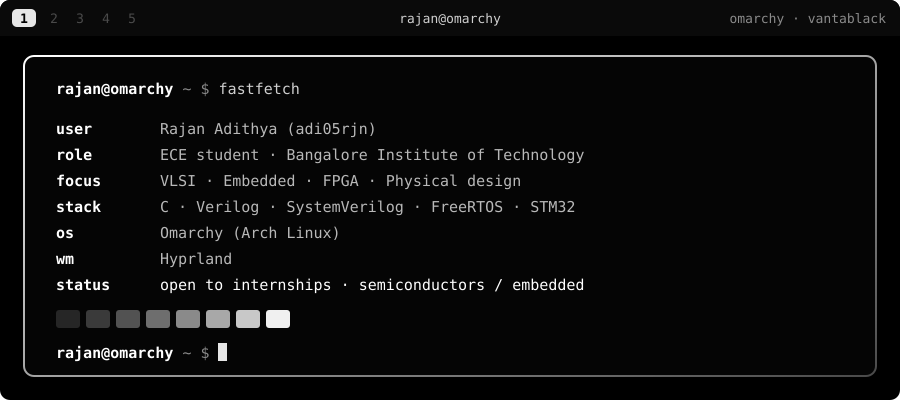
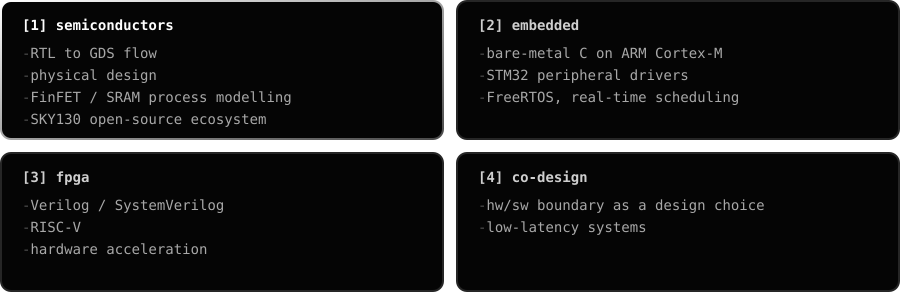

<div align="center">



<br/>


</div>

## ❯ ~/about

I'm an **Electronics & Communication Engineering student** at Bangalore Institute of Technology, interested in systems where the silicon, the firmware and the software are designed together. This GitHub is where I document projects, experiments and what I'm learning along the way.

## ❯ ~/focus

<div align="center">
  
</div>

## ❯ ~/projects

<div align="center">

### `silicon`

<a href="https://github.com/adi05rjn/rtl-to-gds-workshop">
  
</a>
<a href="https://github.com/adi05rjn/finfet-process-simulation">
  
</a>

### `embedded`

<a href="https://github.com/KTL-5002/rtos-scheduler-benchmark-stm32f407">
  
</a>
<a href="https://github.com/adi05rjn/battery-management-system">
  
</a>

### `fpga & more`

<a href="https://github.com/adi05rjn/fpga-automotive-vibration-analysis">
  
</a>
<a href="https://github.com/adi05rjn/openwave-mvp">
  
</a>

</div>

## ❯ ~/exploring

```console
$ cat exploring.txt
high-performance embedded systems and real-time scheduling
physical design: the path from RTL to a tapeout-ready layout
open-source EDA, the SKY130 and OpenROAD ecosystem
FPGA acceleration and low-latency computing
```

## ❯ ~/contact

<div align="center">

[](https://github.com/adi05rjn)

<!-- Add your own links here, for example:
[](https://www.linkedin.com/in/your-handle)
[](mailto:you@example.com)
-->

<br/>


</div>
